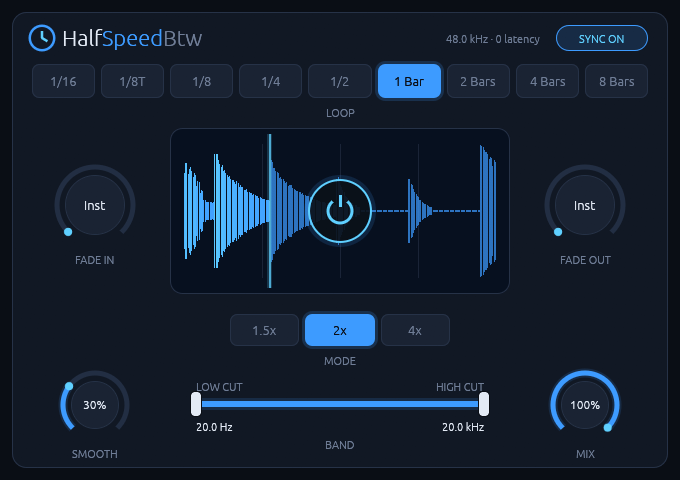
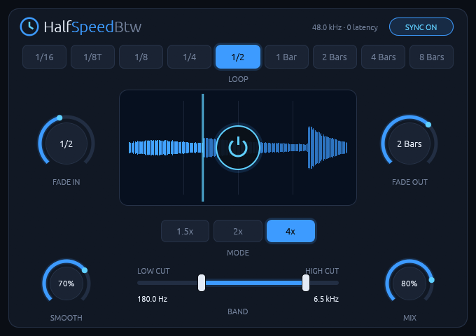

# HalfSpeedBtw

**A tempo-synced half-speed loop effect for Linux, with zero added latency.**
CLAP and VST3, written in Rust.



HalfSpeedBtw makes anything sound like it's playing at half speed (or at 1.5x
or 4x slower) while staying locked to your project's tempo. Put it on drums for
the classic half-time groove, on a vocal for a dragged, pitched-down tail, or
at short loop lengths for tape-stop and stutter effects. Automate the power
switch to drop it in for a fill or a breakdown.

It runs natively on Linux. It has no network access and no telemetry, and it
never allocates memory on the audio thread.

## Features

- **Three slowdown modes:** 1.5x, 2x and 4x slower. The pitch drops with the
  speed, by about a fifth, one octave and two octaves.
- **Nine tempo-synced loop lengths:** 1/16, 1/8T, 1/8, 1/4, 1/2, 1 bar, 2 bars,
  4 bars and 8 bars, following the host's tempo and time signature.
- **Locked to the bar grid:** loops restart on the host's grid while the
  transport plays. They recover cleanly when you seek or when the DAW loops
  back. While the transport is stopped, they keep running at the host tempo.
- **Zero latency:** nothing is reported to the host and there's no lookahead.
  See [How it works](#how-it-works).
- **Musical fades:** separate fade in and fade out lengths for switching the
  effect on and off, from instant up to 16 bars.
- **Smooth:** an equal-power crossfade at every loop restart, from a tight 1 ms
  up to a quarter of the loop.
- **Band:** low cut and high cut filters on the slowed-down signal only, so the
  dry signal keeps its full range.
- **Mix:** blends the dry and slowed-down signals.
- **Live waveform:** the display shows the slowed-down signal across the
  current loop, with a playhead.
- **Click-free:** every parameter change and every loop restart is ramped or
  crossfaded, and all parameters can be automated sample-accurately.
- **Mono and stereo.**

## Screenshots

| Classic half-time: 1 bar, 2x, everything open | Tweaked: 1/2 bar, 4x, fades, narrow band, 80% mix |
| --- | --- |
|  |  |

## Controls

| Control | Range | Default | What it does |
| --- | --- | --- | --- |
| **Power switch** (center of the display) | On / Off | On | Fades the effect in or out. While it's off, the loop keeps running, so switching it back on lands in time. |
| **Loop** | 1/16 to 8 bars | 1 bar | Length of each loop cycle. |
| **Mode** | 1.5x, 2x, 4x | 2x | How much slower the loop plays. |
| **Fade In** | Inst to 16 bars | Inst | How long the effect takes to fade in after you switch it on. |
| **Fade Out** | Inst to 16 bars | Inst | How long it takes to fade out after you switch it off. |
| **Smooth** | 0 to 100% | 30% | Crossfade at each loop restart: 1 ms at 0%, a quarter of the loop at 100%. |
| **Band** | 20 Hz to 20 kHz | Fully open | Low cut and high cut on the slowed-down signal (12 dB/octave). At their end stops the filters are switched off completely. |
| **Mix** | 0 to 100% | 100% | Dry/wet balance. |
| **Sync** (top right) | On / Off | On | On: loops follow the host's bar grid while playing. Off: loops free-run at the host tempo. |

**Mouse:** drag knobs up or down, and hold Shift for fine control.
Double-click a knob or a band handle to reset it. Every control is also
available as a host parameter for automation.

## How it works

At the start of each loop cycle, HalfSpeedBtw begins replaying the audio that
arrives from that moment on, at half speed (or 1/1.5 or 1/4). Halfway through
a 2x cycle, it is playing what came in a quarter of the way through. The
playback position always trails the input, so the effect needs no lookahead
and adds **no latency**. Over one cycle you hear the first half of that
cycle's audio, stretched to fill the whole cycle. Then the next cycle starts
fresh from the present.

Playback is resampled (like slowing down tape), not time-stretched, so pitch
and speed change together. That's the characteristic sound of the effect.

At each restart the old and new playback positions are crossfaded. **Smooth**
sets how long that crossfade is.

**CPU use** is low. The included benchmark runs with both band filters engaged
at 48 kHz in stereo, and takes about 0.25% of one core on average. The slowest
32-sample block used 4% of its time budget. Your numbers will vary; run the
benchmark yourself with the command under [Development](#development).

## Status and compatibility

- **Platform:** Linux x86-64. Developed on Arch Linux.
- **Formats:** CLAP and VST3, both built from the same binary.
- **Hosts:** tested in Bitwig Studio. Other CLAP or VST3 hosts should work but
  haven't been tried yet.
- **Audio:** mono or stereo, at whatever sample rate the host uses. Loops of
  up to 40 seconds of lag fit in the buffer, which covers 8 bars of 4/4 at 4x
  down to 36 BPM. Below that, playback stops slowing down rather than breaking.
- **Display:** X11, or XWayland on a Wayland desktop. The editor renders
  through wgpu, normally on Vulkan.
- **Not built yet:** reverse playback, separate processing for low, mid and
  high bands, and presets.

There are no prebuilt binaries yet; build it from source as described below.

## Build requirements

**To build the plugin:**

- Rust **1.95 or newer**, with Cargo. The easiest way to get it is
  [rustup](https://rustup.rs). The repository's `rust-toolchain.toml` selects
  the stable channel.
- A linker, which Rust uses on Linux anyway: `gcc` or `clang`. No other
  system libraries are needed at build time, because the plugin loads X11 and
  Vulkan at runtime instead of linking them.

**To run the plugin:**

- A CLAP or VST3 host.
- X11 client libraries (`libX11`, `libX11-xcb`, `libxcb`). Any desktop with X11
  or XWayland has them.
- A Vulkan loader and a Vulkan driver for your GPU, from Mesa (AMD/Intel) or
  NVIDIA's proprietary driver. Without Vulkan, wgpu can fall back to OpenGL;
  that path hasn't been tested yet.

**Optional, for the standalone app** (only needed when building with
`--features standalone`):

- ALSA development files and `pkg-config`.
- JACK, or PipeWire's JACK support, if you want to use the JACK backend.
  Install one or the other; on Arch, `pipewire-jack` and `jack2` conflict.

On Arch Linux:

```bash
sudo pacman -S --needed rustup base-devel libx11 libxcb vulkan-icd-loader
```

And for the standalone app:

```bash
sudo pacman -S --needed alsa-lib pkgconf pipewire-jack
```

On other distributions, install the equivalent packages; the names vary.

## Building and installing

Clone the repository and change into it:

```bash
git clone <repository-url> HalfSpeedBtw && cd HalfSpeedBtw
```

Build the release bundles:

```bash
cargo xtask bundle halfspeedbtw --release
```

This writes `HalfSpeedBtw.clap` and `HalfSpeedBtw.vst3` to `target/bundled/`.

Install them for your user:

```bash
mkdir -p ~/.clap ~/.vst3 && cp target/bundled/HalfSpeedBtw.clap ~/.clap/ && cp -r target/bundled/HalfSpeedBtw.vst3 ~/.vst3/
```

Or for all users:

```bash
sudo mkdir -p /usr/lib/clap /usr/lib/vst3 && sudo cp target/bundled/HalfSpeedBtw.clap /usr/lib/clap/ && sudo cp -r target/bundled/HalfSpeedBtw.vst3 /usr/lib/vst3/
```

Then rescan plugins in your DAW. In Bitwig Studio you can instead add
`target/bundled/` as a plugin location while developing.

To uninstall, delete the bundles again:

```bash
rm -rf ~/.clap/HalfSpeedBtw.clap ~/.vst3/HalfSpeedBtw.vst3
```

### Standalone app

For quick tests without a DAW, HalfSpeedBtw can run as a standalone app. With
the dummy backend it opens the editor with silent input:

```bash
cargo run -p halfspeedbtw --features standalone -- --backend dummy
```

With JACK (or PipeWire's JACK support), it processes real audio. Its inputs
aren't connected automatically, so connect them yourself, for example with a
patchbay like `qpwgraph`:

```bash
pw-jack cargo run -p halfspeedbtw --features standalone -- --backend jack --tempo 120
```

Run it with `--help` to see every option, including sample rate, period size
and time signature.

## Development

The workspace has three crates:

| Path | What it is |
| --- | --- |
| `crates/halfspeed-dsp` | The DSP engine: loop clock, playback, crossfades, fades, band filters. It has no dependencies and doesn't depend on any plugin API. |
| `crates/halfspeedbtw` | The plugin: parameters, editor, CLAP/VST3 export and the optional standalone app. |
| `xtask` | `cargo xtask bundle`, which builds the `.clap` and `.vst3` bundles. |

Run the tests and lints:

```bash
cargo test --workspace
```

```bash
cargo clippy --workspace --all-targets
```

The tests cover:

- **Accuracy:** playback matches the input at each slowdown ratio, and the
  output is the same whatever host block size is used.
- **Sync:** loops align to the beat grid and handle transport jumps.
- **Transitions:** fade timing, and no clicks at loop restarts or when a
  filter engages.
- **Filters:** band attenuation, and tails that never decay into slow
  subnormal numbers.
- **Real-time safety:** a counting allocator checks that `process()` never
  allocates memory.
- **Stable IDs:** saved parameter and option IDs never change.

Run the CPU benchmark (real-time factor and worst block per host block size):

```bash
cargo run --release -p halfspeed-dsp --example bench
```

**Rules the code follows:**

- **The audio thread is real-time safe:** no memory allocation, locks, logging
  or file access in `process()`. Buffers are sized in `activate()`. Debug
  builds enable nice-plug's `assert_process_allocs`, which aborts if the audio
  thread allocates.
- **IDs are permanent once released:** these are the parameter and option IDs
  (`#[id = "..."]` in `crates/halfspeedbtw/src/params.rs`), the CLAP ID
  `com.romanhofmann.halfspeedbtw` and the VST3 class ID. DAW projects store
  them, and a test fails if one changes by accident.

### Why wgpu?

nice-plug-egui renders with OpenGL by default. On NVIDIA's proprietary driver
(seen with version 615.78), the OpenGL path segfaulted as soon as the editor
window opened. The cause is that baseview calls `eglGetDisplay` on an X11
connection without saying which platform it is, and NVIDIA's EGL treats it as
a Wayland display. Rendering through wgpu avoids EGL entirely.

## Troubleshooting

- **The plugin doesn't show up:** check that the bundle is in `~/.clap`,
  `~/.vst3`, `/usr/lib/clap` or `/usr/lib/vst3`, then rescan plugins in your
  DAW.
- **The editor window stays black or doesn't open:** check that a Vulkan
  driver is installed. The `vulkaninfo` tool from `vulkan-tools` should list
  your GPU. Bitwig Studio writes plugin errors to
  `~/.BitwigStudio/log/engine.log`.
- **It sounds out of sync:** check that Sync is on and the transport is
  playing. While the transport is stopped, loops free-run and aren't tied to
  the bar grid.

## Licensing

HalfSpeedBtw is free software, licensed under the **GNU General Public License
v3.0 or later** (`GPL-3.0-or-later`). You may use, study, share and modify it.
If you distribute it, modified or not, you must do so under the same license
and make the source code available. See [`LICENSE`](LICENSE) for the full
text.

**Third-party components:** every dependency compiled into the plugin uses a
permissive license compatible with GPLv3: MIT, Apache-2.0, ISC, Zlib, BSD or
Unlicense. Notable ones:

- [nice-plug](https://codeberg.org/RustAudio/nice-plug), the plugin framework:
  ISC.
- [`vst3`](https://crates.io/crates/vst3), the VST3 bindings, and
  [`clap-sys`](https://crates.io/crates/clap-sys), the CLAP bindings: MIT OR
  Apache-2.0.
- [egui](https://github.com/emilk/egui),
  [baseview](https://github.com/RustAudio/baseview) and
  [wgpu](https://github.com/gfx-rs/wgpu), for the GUI: MIT and/or Apache-2.0.
- `self_cell` is offered as Apache-2.0 OR GPL-2.0-only. HalfSpeedBtw uses it
  under Apache-2.0.
- egui's bundled default fonts are licensed under the SIL Open Font License
  1.1 and the Ubuntu Font Licence 1.0. Binary releases must include those
  notices.

To list every crate in the dependency graph with its license, including
build-only and optional ones:

```bash
cargo metadata --format-version 1 | python3 -c "import json,sys; [print(p['name'], p['version'], p.get('license')) for p in json.load(sys.stdin)['packages']]"
```

**Trademarks:** VST is a registered trademark of Steinberg Media Technologies
GmbH. CLAP is an open standard by the free-audio project. HalfSpeedBtw is an
independent project. It isn't affiliated with or endorsed by Steinberg,
Cableguys (makers of HalfTime) or Cymatics (makers of Dejavu), whose plugins
inspired the effect and its layout.

## Acknowledgements

Built on [nice-plug](https://codeberg.org/RustAudio/nice-plug), the
community-maintained successor to Robbert van der Helm's
[NIH-plug](https://github.com/robbert-vdh/nih-plug). The band filters are
based on Andrew Simper's (Cytomic) trapezoidal state-variable filter.
